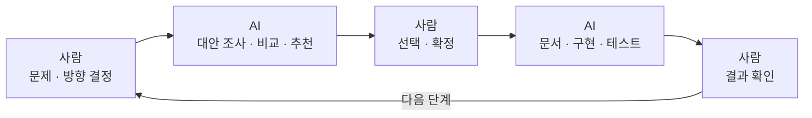
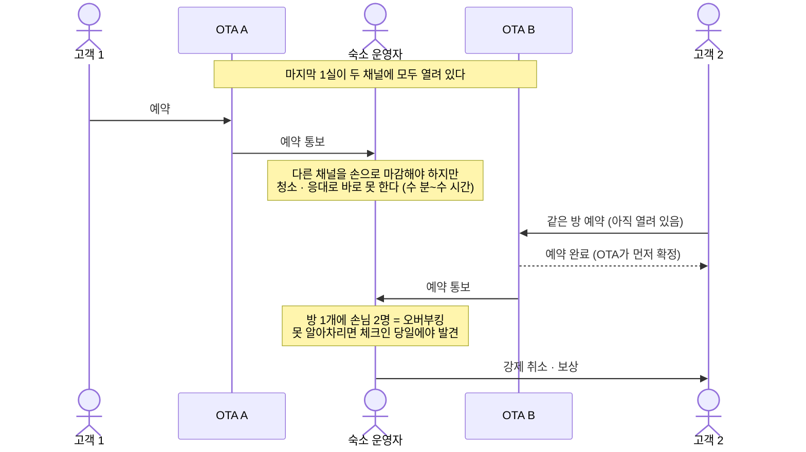
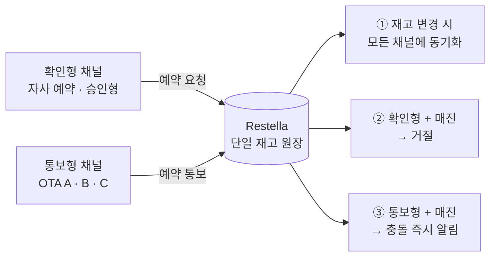
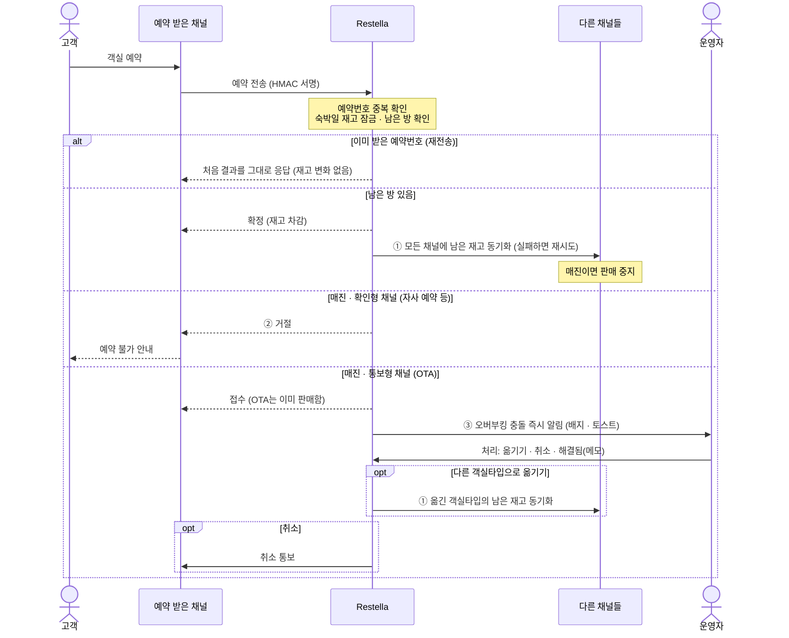
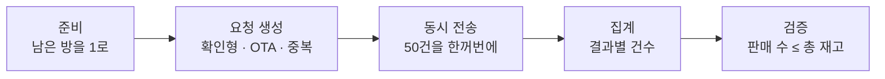
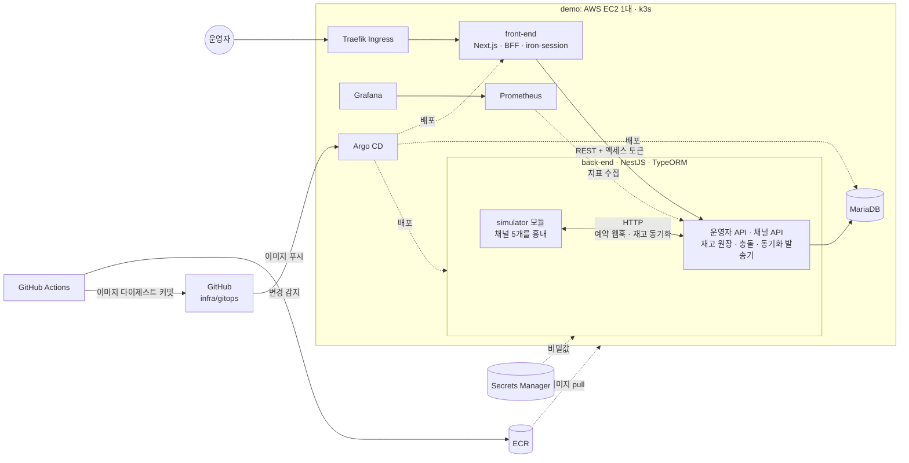

# Restella

> 여러 채널에 동시에 판매하는 소형 숙소를 위한 **단일 재고 원장**.
> 오버부킹을 막고, 막을 수 없는 충돌은 들어온 즉시 드러낸다.

## 작업 과정

사람 한 명과 AI(Claude Code)가 함께 만들었다. 문제, 범위, 설계 방향은 사람이 정했다. 조사, 초안, 구현, 테스트는 AI가 했다. 작업은 **기획 → 디자인 → 개발 → 테스트** 순서로 진행했다. 단계마다 사람이 결과를 확인하고 나서 다음 단계로 넘어갔다. 결정 하나하나와 그때 AI가 한 일은 [AI 활용 기록](docs/ai-log.md)에 시간순으로 있다.



### 단계별 진행

| 단계 | 사람이 정한 것 | AI가 한 일 | 상태 |
|---|---|---|---|
| 1. 기획 | 문제를 "멀티채널 판매 숙소의 오버부킹"으로 정함. 요구사항과 수치 목표 확정 | 문제 후보 3개(오버부킹, 하우스키핑 상태 불일치, 노쇼) 비교와 추천. 요구사항 28개(기능 20, 품질 8)와 완료 조건 초안 | 완료. 문제 정의 보강 남음 |
| 2. 디자인 | 화면 설계는 레포 안 HTML 목업으로. 시뮬레이터는 back-end 안 모듈로. 설계 확정 | 도메인 모델·잠금 순서·API 설계. 동시성·중복·동기화·실시간 알림 방식 비교([ADR-0004](docs/adr/0004-reservation-consistency-and-sync.md)). 목업과 스크린샷 10장 | 완료 |
| 3. 개발 | DTO는 NestJS 관례대로. FSD `entities`·`features` 없애고 `widgets`는 유지. 오류 응답은 RFC 9457 | back-end 모듈 9개, front-end 화면 7개와 BFF, 컨테이너 이미지 | 완료. 코드 리뷰 대기 |
| 4. 테스트 | 결과 확인 | 불변식 테스트를 먼저 작성. 동시성은 실제 MariaDB로, 시연 시나리오는 실제 브라우저로 검증. 테스트로 문제 12건을 찾아 고침 | 로컬 완료. demo 검증 남음 |
| 인프라 | demo(실제 배포)와 prod(코드만) 분리. OS는 Amazon Linux 2023(AI는 Ubuntu 추천). t4g.large 스팟. Route 53은 공용 `global` 스택으로. 비밀값은 1개에 `fe`·`be` 키 2개. 워크플로는 앱별로. 노드는 gitops 준비 뒤에 | Terraform(bootstrap·global 적용, demo는 ECR·비밀값·CI 역할만 적용), 앱별 CI 워크플로, MariaDB 차트, Argo CD·ESO 클러스터 구성. 같은 버전의 k3s를 로컬에 띄워 검증. 결정 기록([ADR-0001~0003, 0005](docs/adr/)) | 진행 중 |

### AI 결과를 검증한 방법

- **불변식 테스트 먼저:** "판매 수 ≤ 총 재고", "같은 예약은 한 번만"을 테스트로 먼저 고정하고 구현했다.
- **실제 출력이 기준:** 버전과 API는 기억이 아니라 레지스트리, 공식 문서, 실제 도구의 출력으로 확인했다.
- **새 컨텍스트에서 리뷰:** 구현과 분리된 컨텍스트에서 `/code-review`로 리뷰하고, 지적마다 반영·기각과 이유를 [코드 리뷰 기록](docs/3-development/code-review.md)에 남긴다.
- **사람이 최종 판정:** 리뷰어와 구현자가 같은 모델 계열이다. 그래서 마지막 관문은 테스트와 사람의 판정이다.

이 과정에서 AI의 실수나 놓친 점을 잡은 사례다.

| 사례 | 무엇을 잡았나 |
|---|---|
| [#1 버전 선정](docs/ai-log.md#1-버전-선정-p0) | "모두 최신" 원칙이 호환성 충돌을 일으킴. 사람이 "호환성 → LTS → 최신" 순서로 원칙을 바꿈 |
| [#2 k3s 설치 스크립트](docs/ai-log.md#2-k3s-설치-스크립트의-al2023-판별-p4) | 문서 대신 스크립트 원문을 읽고, Amazon Linux 2023을 CentOS 8로 오판하는 문제를 찾음 |
| [#3 NestJS 템플릿](docs/ai-log.md#3-nestjs-12-템플릿의-실제-구성-p2) | AI가 문서에 Jest라고 적었지만 실제 생성 결과는 Vitest였음 |
| [#4 E2E 교착](docs/ai-log.md#4-e2e-테스트가-드러낸-교착-p2) | 실패를 덮지 않고 원인을 분리함. 교착 대비 재시도 장치 추가 |
| [#5 DTO 누락](docs/ai-log.md#5-dto-위치와-응답-dto-누락-p2) | AI가 묻지 않고 관례에서 벗어난 구조를 택한 것을 사람이 지적함 |
| [#6 front-end E2E](docs/ai-log.md#6-front-end-e2e가-드러낸-문제-p3) | 테스트 실패를 추적하다 비밀번호가 URL에 실릴 수 있는 문제를 찾음 |

### 문서

단계별 산출물이다. 요구사항 하나가 설계, 구현, 테스트, 결과로 어떻게 이어지는지는 [요구사항 추적표](docs/4-testing/traceability.md)에서 확인할 수 있다.

**1. 기획**

| 문서 | 내용 |
|---|---|
| [진행 계획](docs/1-planning/plan.md) | 단계별 계획과 진행 현황 |
| [문제 정의](docs/1-planning/problem.md) | 대상 사용자, 상황, 손실, 도메인 제약, 목표 |
| [범위](docs/1-planning/scope.md) | 포함·제외 항목과 그 이유 |
| [요구사항](docs/1-planning/requirements.md) | 기능 20개·품질 8개, ID와 완료 조건, 우선순위(MoSCoW) |

**2. 디자인**

| 문서 | 내용 |
|---|---|
| [아키텍처](docs/2-design/architecture.md) | 구성 요소 사이의 요청 흐름, 예약 한 건의 흐름, 관측 |
| [도메인 모델·ERD](docs/2-design/domain-model.md) | 테이블, 예약 상태 전이, 예약·취소 트랜잭션과 잠금 순서 |
| [API 명세](docs/2-design/api.md) | 채널 API(HMAC 서명), 운영자 API, 채널 동기화 계약, 오류 형식 |
| [front-end 설계](front-end/README.md) | 운영자 콘솔: 역할과 경계, 화면, 인증 흐름, FSD 구조 |
| [back-end 설계](back-end/README.md) | 재고 원장 API: 책임, API 경계, 동시성·중복 요청 처리, 모듈, 테스트, 실행 방법 |
| [infra 설계](infra/README.md) | demo·prod 환경, Terraform·GitOps 구성, 배포 파이프라인, 운영 원칙 |
| [기술 스택](docs/2-design/tech-stack.md) | 버전 선정 원칙과 버전표 |
| [보안](docs/2-design/security.md) | 공개 저장소 원칙: 비밀값·민감 정보·개인정보 차단 |
| [화면 설계](docs/2-design/ui/README.md) | 화면 목록, 화면 흐름, "마지막 1실" 시연 시나리오, 와이어프레임 |

**3. 개발**

| 문서 | 내용 |
|---|---|
| [코딩 규칙](docs/3-development/conventions.md) | 잠금 순서, 트랜잭션, 날짜, 시뮬레이터 경계 등 구현 규칙 |
| [back-end 구현 노트](docs/3-development/back-end.md) | 구현 결과, 설계에서 바뀐 점과 이유 |
| [front-end 구현 노트](docs/3-development/front-end.md) | 화면별 서버 렌더링 데이터, 설계에서 바뀐 점과 이유 |
| [API 목록](docs/3-development/api-reference.md) | 구현된 엔드포인트 전체: 메서드, 경로, 인증, 요구사항 |
| [코드 리뷰 기록](docs/3-development/code-review.md) | `/code-review` 결과와 반영·기각 이유 |

**4. 테스트**

| 문서 | 내용 |
|---|---|
| [테스트 전략](docs/4-testing/test-strategy.md) | 수준별 범위, 실제 DB로 검증하는 이유, 동시성 테스트 설계 |
| [요구사항 추적표](docs/4-testing/traceability.md) | 요구사항 → 설계 → 구현 → 테스트 → 결과 |
| [테스트 결과 보고서](docs/4-testing/test-report.md) | 실행 결과, 커버리지, 테스트로 발견하고 고친 문제 |

**단계 공통**

| 문서 | 내용 |
|---|---|
| [AI 활용 기록](docs/ai-log.md) | 사람의 결정과 AI가 한 일, 검토 방법, 검토 사례 |
| [ADR](docs/adr/) | 설계 결정 기록 |

## 한눈에 보기

**오버부킹은 숙소와 고객이 함께 손해 보는 사고다.** 고객은 여행 당일 묵을 곳을 잃고, 숙소는 보상금과 채널 페널티, 나쁜 리뷰를 떠안는다. Restella는 이 사고를 줄이고, 그래도 생기면 바로 드러내서 양쪽의 손해를 줄인다.

| 숙소 운영자에게 좋은 점 | 고객에게 좋은 점 |
|---|---|
| **손실이 준다.** 강제 취소 보상금, 채널 페널티, 나쁜 리뷰가 줄어든다 | **확정된 예약을 믿을 수 있다.** 도착했는데 방이 없는 일이 줄어든다 |
| **더 많이 판다.** 겹칠까 봐 일부 채널을 미리 닫을 필요 없이, 마지막 1실까지 모든 채널에 열어 둘 수 있다 | **빨리 안다.** 매진이면 예약하는 순간에, 겹쳤으면 예약 직후에 안다 |
| **일이 준다.** 채널을 손으로 막는 일이 사라지고, 화면에 뜬 충돌만 처리하면 된다 | **대안이 생긴다.** 숙소가 미리 연락해 다른 객실로 옮겨 주거나, 다른 숙소를 찾을 시간이 남는다 |

고객이 믿고 예약할 수 있어야 좋은 리뷰와 재예약이 늘고, 그것이 숙소의 매출로 돌아온다. 그래서 오버부킹을 줄이는 일은 고객 경험이면서 동시에 숙소의 매출 문제다. 상황별 비교는 [무엇이 달라지나](#무엇이-달라지나)에 있다.

## 서비스 소개

### 문제 상황

소형 숙소는 같은 객실을 여러 채널(OTA, 자사 예약)에 동시에 판다. 한 채널에서 팔리면 운영자가 다른 채널을 손으로 마감하는데, 마감하기 전에 같은 방이 다른 채널에서 또 팔린다.



| 구분 | 내용 |
|---|---|
| **누가** | 10~30실 규모 소형 숙소 운영자(펜션, 게스트하우스, 부티크 호텔). 3~5개 채널에 판매하고, 채널매니저는 비용 때문에 쓰지 않는다 |
| **언제** | 한 채널에서 팔린 뒤 다른 채널을 마감하기까지의 수 분~수 시간. 성수기 마지막 1실에서 특히 자주 생긴다 |
| **손실** | 강제 취소와 보상, 채널 페널티, 리뷰 평판 하락. 이를 피하려고 마지막 방을 일부 채널에서 미리 닫으면, 팔 수 있는 방을 못 판다 |
| **어려운 점** | 대부분의 OTA는 예약을 먼저 확정하고 숙소에는 나중에 알린다. 그래서 숙소 쪽 시스템만으로는 오버부킹 0건을 보장할 수 없다 |

쉽게 풀어 쓴 설명(펜션 칠판 비유)과 자세한 분석은 [문제 정의](docs/1-planning/problem.md)에 있다.

### 해결 방안

Restella는 모든 채널의 예약을 **하나의 재고 원장**으로 모은다. 채널마다 따로 있던 재고 대신 원장 하나가 기준이 되고, 채널이 예약을 받는 방식에 따라 다르게 대응한다.

- **확인형 채널:** 예약을 확정하기 전에 재고를 물어보는 채널. 자사 예약, 승인형 채널 등.
- **통보형 채널:** 예약을 먼저 확정하고 나중에 알려 주는 채널. 대부분의 OTA.



| 목표 | 해결하는 문제 | 방법 | 기준 |
|---|---|---|---|
| ① 충돌 창 축소 | 손으로 마감하는 동안 다른 채널에서 또 팔린다 | 판매·취소·재고 조정이 일어나면 모든 채널에 남은 재고를 바로 보낸다. 실패하면 다시 보낸다 | 5초 이내 전송 |
| ② 원천 차단 | 확인형 채널의 초과 판매 | 숙박일 재고를 잠그고 확인한 뒤 매진이면 거절한다. DB 제약으로 한 번 더 막는다 | 초과 판매 0건 |
| ③ 즉시 감지 | 통보형 채널은 이미 팔고 알려 오므로 막을 수 없다 | 충돌로 기록하고 운영자 콘솔에 바로 알린다. 운영자는 다른 객실타입으로 옮기기, 취소, 해결됨 중에서 처리한다 | 5초 이내 화면 표시 |

#### 무엇이 달라지나

Restella를 직접 쓰는 사람은 운영자다. 고객은 Restella 화면을 보지 않고, 그 결과로 혜택을 받는다.

**고객: "방이 없다"는 말을 늦게 듣지 않는다**

| 상황 | 지금 | Restella 이후 |
|---|---|---|
| 확인형 채널(자사 예약 등)에서 예약 | 매진인데 예약이 받아졌다가 나중에 취소 연락을 받을 수 있다 | 매진이면 예약하는 순간 "예약 불가"를 본다 |
| 통보형 채널(OTA)에서 예약 | 이미 팔린 방이 OTA에 수 분~수 시간 열려 있다 | 몇 초 안에 판매가 중지되어, 겹칠 확률 자체가 줄어든다 |
| 그래도 겹쳤을 때 | 체크인 당일에 "방이 없습니다"를 듣는다 | 예약 직후 숙소의 연락을 받아, 다른 객실이나 숙소를 찾을 시간이 있다 |

**운영자: 손으로 막던 일은 시스템이 하고, 사람은 예외만 처리한다**

| 일 | 지금 | Restella 이후 |
|---|---|---|
| 다른 채널 마감 | 예약이 올 때마다 채널 3~5곳을 손으로 막는다 | 모든 채널에 남은 재고가 자동으로 간다 |
| 마지막 방 판매 | 겹칠까 봐 일부 채널에서 미리 닫아, 팔 수 있는 방을 못 판다 | 마지막 1실까지 모든 채널에 열어 둘 수 있다 |
| 재고 확인 | 채널마다 들어가서 본다 | 재고 달력 하나로 전체를 본다 |
| 오버부킹 발견 | 체크인 날 손님이 와서야 안다 | 예약이 들어온 순간 화면에 알림(배지, 토스트)이 뜬다 |
| 오버부킹 처리 | 전화와 메모로 그때그때 대응한다 | 충돌 처리함에서 다른 객실타입으로 옮기기, 취소(채널에 자동 통보), 해결됨(메모) 중 하나를 고른다 |
| 사후 확인 | 기억과 메신저 기록에 의존한다 | 모든 단계가 이벤트 로그에 시간순으로 남아, 채널과 분쟁이 생기면 근거가 된다 |
| 동기화 문제 | 채널에 반영됐는지 알 수 없다 | 채널별로 받은 재고를 화면에서 비교한다. 실패한 전송은 자동으로 다시 보낸다 |

### 서비스 흐름

예약 한 건이 들어와서 처리되기까지의 흐름이다. ①②③은 위 해결 방안의 목표 번호다.



- **동시 요청:** 같은 날짜의 재고는 한 번에 한 요청만 확인하고 차감한다. 그래서 마지막 1실에 요청이 몇 건 동시에 들어와도 확정은 1건뿐이다.
- **운영자 변경:** 운영자가 확정 예약을 취소하거나 총 재고를 조정해도 같은 방식으로 모든 채널에 동기화한다.
- **기록과 화면:** 모든 단계는 이벤트 로그에 시간순으로 남고, 운영자 콘솔에 새로고침 없이 반영된다.
- **세부 설계:** [아키텍처](docs/2-design/architecture.md#예약-한-건의-흐름)와 [도메인 모델](docs/2-design/domain-model.md)에 있다.

### 주요 기능

| 기능 | 설명 |
|---|---|
| 재고 원장 | 객실타입 × 숙박일(박) 단위로 재고를 관리한다 |
| 예약 수신 | 채널 예약을 받아 재고를 차감한다. 연박은 모든 날짜를 한꺼번에 잡고, 동시 요청과 중복 요청에도 정확하게 처리한다 |
| 채널 동기화 | 재고가 바뀌면 모든 채널에 남은 수량을 보낸다 |
| 충돌 처리함 | 매진된 객실에 들어온 통보형 예약을 '오버부킹 충돌'로 모아 보여준다 |
| 운영자 콘솔 | 로그인, 재고 달력, 예약 목록, 충돌 처리함, 이벤트 로그 |
| 채널 시뮬레이터 | 실제 OTA 대신 가짜 채널 5개 역할을 하고, 남은 1실에 여러 채널이 동시에 예약할 때의 결과를 화면에서 확인한다 ([아래 설명](#채널-시뮬레이터)) |

### 채널 시뮬레이터

Restella는 예약을 보내 주고 남은 재고를 받아 줄 채널이 있어야 동작한다. 그런데 실제 OTA에 연결하려면 파트너 계약이 필요하다. 또 오버부킹은 마지막 1실에 예약이 **동시에** 몰릴 때 생기는데, 사람이 손으로는 이런 상황을 만들 수 없다. 그래서 back-end 안에 가짜 채널과 동시 예약 실험을 맡는 `simulator` 모듈을 두었다. 자동차 충돌 테스트에서 사람 대신 마네킹을 태워 안전벨트를 시험하는 것과 같다.

**역할 1: 가짜 채널 5개**

확인형 채널 2개(`DIRECT` 자사 예약, `APPROVAL` 승인형 채널)와 통보형 채널 3개(`OTA_A`, `OTA_B`, `OTA_C`)인 척한다.

| 하는 일 | 실제 OTA라면 | 시뮬레이터에서는 |
|---|---|---|
| 예약 보내기 | 손님이 예약하면 숙소에 알린다 | 채널별 키로 서명해서 Restella 채널 API로 보낸다 |
| 남은 재고 받기 | 받은 숫자를 OTA 화면에 반영한다 | 받은 숫자를 기억한다. 운영자는 "채널별 재고" 화면에서 이 값을 원장과 비교한다 |
| 취소 통보 받기 | 숙소가 취소한 예약을 정리한다 | 받은 취소를 기록한다 |
| 오래된 값 무시 | 순서가 뒤바뀌어 온 옛날 값은 버린다 | 이미 받은 것보다 오래된 revision은 버린다 |
| 장애 | 가끔 느리거나 실패한다 | 채널별로 실패율과 지연을 줄 수 있다. Restella의 동기화 재시도를 시연하는 데 쓴다 |

**역할 2: "마지막 1실" 실험**

운영자가 시뮬레이터 화면에서 조건을 넣고 실행하면 아래 순서로 진행한다.



남은 방 1, 요청 50건, 통보형 40%, 중복 10%로 실행하면 고유 예약 45건(OTA 18건, 확인형 27건)과 중복 5건이 나간다. 결과는 이렇게 읽는다.

| 결과 | 건수 | 이유 |
|---|---|---|
| 확정 | 1 | 방이 1개라서 먼저 잡은 1건만 확정된다 |
| 거절 | 26 | 확인형 27건에서 확정된 1건을 뺀 나머지. 매진이라 거절된다 |
| 충돌 | 18 | OTA 18건은 이미 팔고 알려 온 것이라 충돌로 기록된다 |
| 중복 | 5 | 같은 예약번호를 다시 보낸 것이다. 처음 결과를 그대로 받고 재고는 바뀌지 않는다 |

확정을 OTA가 먼저 잡으면 거절 27, 충돌 17이 된다. 누가 잡든 **확정은 항상 1건**이어야 하고, 실험은 마지막 단계에서 이를 확인한다.

**HTTP로만 대화한다**

시뮬레이터는 같은 앱 안에 있지만 Restella 내부 코드를 직접 부르지 않는다. 실제 OTA와 같은 HTTP 계약(서명된 예약, 재고 동기화)만 쓴다.
- **같은 길로 시험한다:** 서명 검사, 중복 처리, 동시성 처리를 실제 OTA 요청과 같은 길로 시험할 수 있다. 내부 함수를 직접 부르면 이 과정을 건너뛰어 실험의 의미가 없다.
- **바꾸기 쉽다:** 나중에 실제 OTA로 바꾸거나 별도 앱으로 떼어 내도 Restella 쪽 코드는 그대로다.
- **규칙을 강제한다:** 이 경계는 린트 규칙으로 막는다. 세부 내용은 [back-end 설계](back-end/README.md#시뮬레이터의-경계)에 있다.

### 검증 결과

로컬 환경에서 확인한 결과다(시뮬레이션·화면 2026-10-10, 자동 테스트 재실행 2026-10-11). demo 배포 결과는 배포하면서 추가한다.

| 확인 항목 | 결과 |
|---|---|
| 마지막 1실에 동시 예약 50건<br/>(확인형·통보형·중복 요청 섞음) | 확정 1 · 거절 26 · 충돌 18 · 중복 5, **초과 판매 0건**, 0.14초 |
| 채널 동기화 | 5개 채널 모두 남은 재고 0(판매 중지)을 받음 |
| 자동 테스트 (back-end) | 단위 20개, 통합·E2E 60개 모두 통과. 라인 커버리지 94.7% |
| 자동 테스트 (front-end) | 단위 21개 모두 통과 |
| 운영자 콘솔 (front-end) | "마지막 1실" 시연 시나리오 전체를 실제 브라우저로 검증. 충돌 알림이 새로고침 없이 5초 안에 뜨고, 5개 채널 모두 판매 중지를 받음 |

자세한 내용은 [테스트 결과 보고서](docs/4-testing/test-report.md)에 있다.

### 범위

문제 해결에 필요한 것만 만들었다. 나머지는 아래 이유로 제외했다([범위 문서](docs/1-planning/scope.md)).

| 제외 | 이유 | 대신 |
|---|---|---|
| 실제 OTA API 연동 | 파트너 계약이 필요하다 | back-end 안의 `simulator` 모듈이 실제 채널과 같은 HTTP 계약으로 채널 5개를 흉내 낸다 |
| 결제, 요금, 회원, 객실 배정, 여러 숙소 | 오버부킹 문제와 관계가 없다 | - |
| Redis 분산 락, 메시지 큐 | DB 트랜잭션으로 충분하다 | MariaDB 행 잠금과 동기화 상태 테이블 ([ADR-0004](docs/adr/0004-reservation-consistency-and-sync.md)) |
| 고가용성(멀티 노드, 관리형 DB) | 과제 규모에 비해 비싸다 | EC2 1대 + 매일 EBS 스냅샷. 실무용 설계는 코드로만 둔다 |

## 전체 구조

### 시스템 구성



| 구성 요소 | 역할 | 기술 |
|---|---|---|
| front-end | 운영자 콘솔. 세션을 보관하고 back-end API를 대신 호출하는 BFF | Next.js, iron-session, TanStack Query, Tailwind CSS, FSD |
| back-end | 재고 원장, 예약 수신·취소, 채널 동기화, 충돌 관리. 채널을 흉내 내는 `simulator` 모듈도 이 앱 안에 있다 | NestJS, TypeORM, Swagger |
| DB | 재고, 예약, 충돌, 이벤트 저장 | MariaDB |
| infra | EC2 1대 위의 k3s 클러스터, GitOps 배포, 모니터링 | Terraform, k3s, Helm, Argo CD, Prometheus, Grafana |
| CI | 테스트, 이미지 빌드·푸시, 이미지 다이제스트를 gitops에 반영 | GitHub Actions, ECR |
| 비밀값 | DB 비밀번호, 세션 키 등을 클러스터에 전달 | AWS Secrets Manager, External Secrets Operator |

- 운영자는 front-end에만 접속한다. 로그인 토큰은 front-end 서버의 암호화 쿠키에 있고, 브라우저 요청은 front-end를 거쳐 back-end로 간다.
- 채널은 back-end의 채널 API를 HTTP로 호출하고, 남은 재고도 HTTP로 받는다. 데모에서는 back-end 안의 `simulator` 모듈이 채널 역할을 한다. 이 모듈은 실제 채널과 같은 HTTP 계약만 쓰고 내부 코드를 직접 부르지 않는다. 그래서 나중에 실제 OTA 연결이나 별도 앱으로 바꾸기 쉽다.
- 모든 구성 요소는 AWS EC2 1대의 k3s 클러스터에서 실행되고, Argo CD가 Git의 `infra/gitops`를 기준으로 배포한다.
- 인프라는 두 환경으로 나뉜다. 위 그림은 실제로 배포하는 **demo**(퍼블릭 EC2, Let's Encrypt)다. **prod**는 ALB·NAT·프라이빗 서브넷을 쓰는 실무용 설계로, 비용 문제로 배포하지 않고 코드로만 둔다([ADR-0001](docs/adr/0001-network-topology.md)).

### 디렉토리 구조

```
restella/
├── README.md                   # 작업 과정과 문서, 서비스 소개, 전체 구조
├── compose.yaml                # 로컬 전체 실행 (Docker): MariaDB → back-end → front-end
├── .env.example                # compose.yaml이 읽는 로컬 값의 예시 (.env는 커밋하지 않음)
├── .github/workflows/          # CI: 테스트 → 이미지 빌드·ECR 푸시 → gitops에 이미지 다이제스트 반영
├── docs/                       # 단계별 문서: 기획 → 디자인 → 개발 → 테스트
│   ├── 1-planning/             # 기획: 계획, 문제 정의, 범위, 요구사항
│   ├── 2-design/               # 디자인: 아키텍처, 기술 스택, 보안, 도메인·API 설계
│   │   └── ui/                 # 화면 설계: 화면 흐름, 와이어프레임 (레포 안에 보관)
│   ├── 3-development/          # 개발: 코딩 규칙, 구현 노트, 코드 리뷰 기록
│   ├── 4-testing/              # 테스트: 테스트 전략, 결과 보고서, 요구사항 추적표
│   ├── adr/                    # 설계 결정 기록 (단계 공통)
│   └── ai-log.md               # AI 활용 기록 (단계 공통)
├── front-end/                  # Next.js 프로젝트 루트 (README.md: front-end 설계)
│   ├── app/                    # Next.js App Router. 라우팅 전용이며 src/_pages를 re-export
│   ├── public/
│   └── src/                    # FSD 레이어. 위 레이어가 아래 레이어만 import한다
│       ├── _app/               # 프로바이더, 전역 스타일, 세션 설정, BFF 로직(api-routes/)
│       ├── _pages/             # 화면 단위 조합
│       ├── widgets/            # 독립적인 큰 UI 블록
│       └── shared/             # api · config · lib · ui. 여러 레이어가 함께 쓰는 코드 (entities 레이어는 두지 않음)
├── back-end/                   # NestJS 프로젝트 루트 (README.md: back-end 설계)
│   ├── src/
│   │   ├── common/             # 예외 필터, 인터셉터, 가드, 데코레이터
│   │   ├── config/             # 환경변수 검증, TypeORM·Swagger 설정
│   │   ├── database/           # 마이그레이션, 시드 데이터
│   │   └── modules/            # 도메인 모듈
│   └── test/                   # e2e, 동시성 통합 테스트
└── infra/                      # README.md: infra 설계
    ├── terraform/              # AWS 리소스 (VPC, EC2, EBS, ALB 등)
    │   ├── bootstrap/          # Terraform state용 S3 버킷
    │   ├── global/             # 환경들이 함께 쓰는 계정 단위 리소스: Route 53 호스팅 영역, GitHub Actions OIDC 공급자
    │   ├── modules/            # network, k3s-node, ecr, alb
    │   └── envs/               # demo(실제 배포), prod(실무용 설계, 배포 안 함)
    └── gitops/                 # Argo CD가 감시하는 디렉토리
        ├── bootstrap/          # Argo CD 설치와 환경별 루트 Application
        ├── apps/               # 환경별 하위 Application 정의 (demo, prod)
        ├── charts/             # 자체 Helm 차트: front-end, back-end, mariadb
        └── values/             # 환경별 values (demo, prod)
```

front-end는 FSD(Feature-Sliced Design) 구조를 따른다. FSD의 `app`·`pages` 레이어는 Next.js 라우터와 이름이 겹치지 않도록 `_app`·`_pages`로 둔다.
