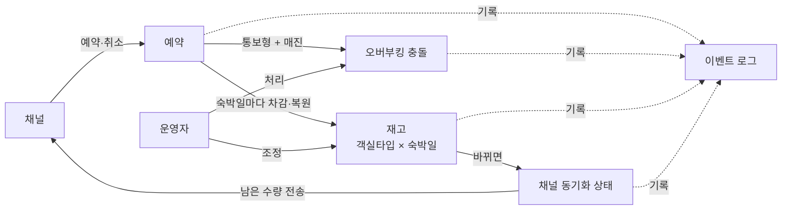
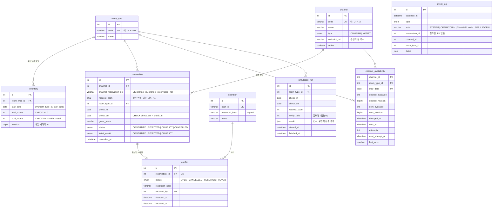
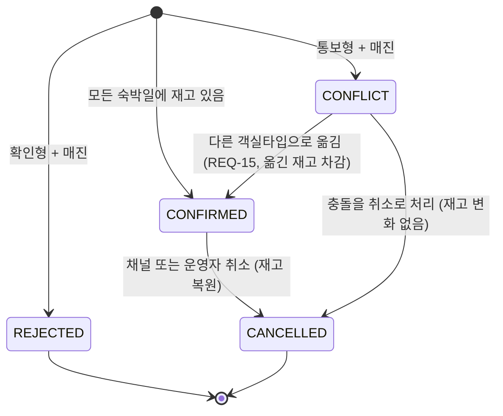
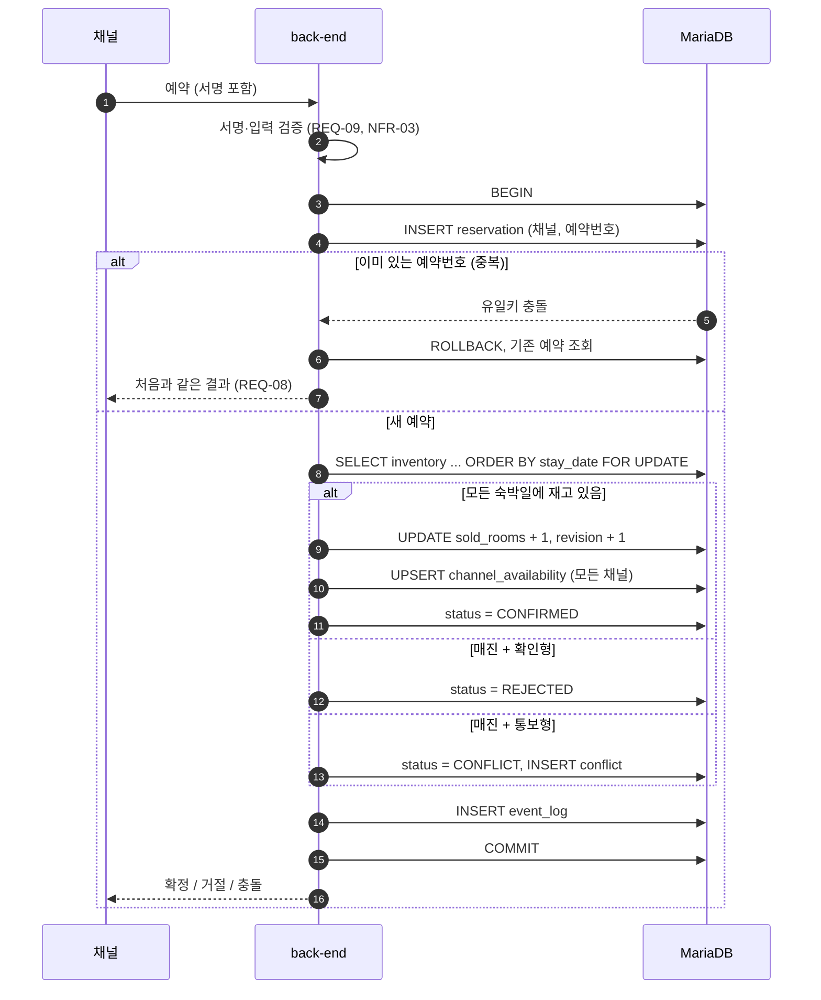

# 도메인 모델과 ERD

[요구사항](../1-planning/requirements.md)을 데이터 구조로 옮긴다. DB는 MariaDB 12.3(InnoDB)이다. 테이블별로 근거가 되는 요구사항 ID를 적는다.

## 도메인 개요

## ERD

모든 테이블에는 `created_at`, `updated_at`이 있다. 그림에서는 생략했다.

ID와 외래 키는 `INT UNSIGNED`다. 계속 커지는 `revision` 계열만 `BIGINT`다. 구현 단계에서 BIGINT에서 바꿨다([구현 노트](../3-development/back-end.md)).

## 테이블

### room_type: 객실타입

판매 단위다. 개별 객실 번호는 다루지 않는다([범위](../1-planning/scope.md)).

### inventory: 재고 (REQ-01, 02, 03, 05 / NFR-01)

| 컬럼 | 설명 |
|---|---|
| `stay_date` | 숙박일. `Asia/Seoul` 기준 날짜(NFR-08). 체크아웃 날짜는 숙박일이 아니다 |
| `total_rooms`, `sold_rooms` | 총 재고와 판매 수. 남은 재고는 `total_rooms - sold_rooms`로 계산하고 저장하지 않는다 |
| `revision` | 재고가 바뀔 때마다 1씩 는다. 채널 동기화에서 최신 값을 판별하는 데 쓴다(REQ-12 AC-12-3) |

**제약:**
- `UNIQUE(room_type_id, stay_date)`
- `CHECK (total_rooms >= 0)`
- `CHECK (sold_rooms >= 0 AND sold_rooms <= total_rooms)`
- 마지막 제약이 NFR-01의 DB 차원 보장이다. 로직이 틀려도 초과 판매는 저장되지 않는다.

재고 행이 없는 날짜는 판매하지 않는다(AC-01-3). 데모 데이터는 시드로 앞으로 90일치 재고를 만든다.

### channel: 채널 (REQ-06, 07, 09)

| 컬럼 | 설명 |
|---|---|
| `type` | `CONFIRM`(확인형): 매진이면 거절한다. `NOTIFY`(통보형): 매진이면 충돌로 기록한다 |
| `code` | 웹훅 요청 헤더로 채널을 식별하는 값 |
| `endpoint_url` | 채널 수신 기본 주소. `{endpoint_url}/availability`로 재고 동기화를, `{endpoint_url}/cancellations`로 취소 통지를 보낸다 |

서명 검증용 비밀 키는 **DB에 두지 않는다.** Secrets Manager의 `restella-demo`에서 External Secrets Operator를 거쳐 환경변수로 받는다([보안](security.md)).

### reservation: 예약 (REQ-04, 06, 07, 08, 10, 16)

| 컬럼 | 설명 |
|---|---|
| `channel_reservation_no` | 채널이 붙인 예약번호. `UNIQUE(channel_id, channel_reservation_no)`가 중복 요청 처리(REQ-08)의 근거다 |
| `request_hash` | 요청 본문의 SHA-256. 같은 번호로 다른 내용(날짜 등)이 오면 중복이 아니라 오류로 처리한다 |
| `status` | 아래 상태 전이 참고. 거절(`REJECTED`)도 저장한다 |
| `initial_result` | 처음 처리 결과(확정, 거절, 충돌). `status`는 이후 취소 등으로 바뀌지만, 같은 요청이 다시 오면 이 값을 돌려준다(AC-08-2) |
| `guest_name` | 화면 표시용 이름만 저장한다. 연락처는 저장하지 않는다(NFR-04) |

**제약:** `CHECK (check_out > check_in)` (AC-01-2)

충돌을 "해결됨"으로 처리하면 예약은 `CONFLICT` 상태로 남고, `conflict.status`만 `RESOLVED`가 된다. 예약이 숙소 밖에서 해결되었다는 기록이다.

### conflict: 오버부킹 충돌 (REQ-07, 13, 14, 15)

예약과 1:1이다. 충돌 처리함은 `status = OPEN`인 행을 보여준다. "해결됨"으로 처리할 때 `resolution_note`는 필수다(AC-14-2).

### channel_availability: 채널 동기화 상태 (REQ-11, 12, 20)

채널 × 객실타입 × 숙박일마다 **채널에 보내야 할 값(desired)**과 **채널에 마지막으로 보낸 값(sent)**을 둔다. 근거는 [ADR-0004](../adr/0004-reservation-consistency-and-sync.md)에 있다.

- **기록:** 재고가 바뀌는 트랜잭션 안에서 모든 채널의 해당 행에 `desired_*`를 쓴다(upsert). 재고 변경과 동기화 기록이 함께 커밋되므로, 서버가 중간에 죽어도 동기화가 누락되지 않는다.
- **전송:** 발송기는 `desired_revision > sent_revision`이고 `next_attempt_at`이 지난 행을 골라 채널에 보낸다.
  - 성공하면 `sent_*`와 `sent_at`을 갱신한다.
  - 실패하면 `attempts`를 늘리고 다음 시도 시각을 뒤로 미룬다. 간격은 점점 늘어나고, 최대 5회다.
- **최신 값만 전송:** 재시도 중에 재고가 또 바뀌면 행이 최신 값으로 덮인다. 그래서 항상 최신 값만 나간다(AC-12-3). 채널에는 `revision`도 함께 보내서, 늦게 도착한 오래된 값을 채널이 무시할 수 있게 한다.
- **지표와 화면:** 동기화 지연(`sent_at - changed_at`)은 NFR-05 지표다. `sent_available`과 `sent_at`은 "채널별 재고 보기"(REQ-20) 화면의 데이터다.

### event_log: 이벤트 로그 (REQ-17)

- **기록 방식:** 추가만 하고 수정하지 않는다. 다른 테이블과 외래 키를 걸지 않는다. 대상이 바뀌거나 지워져도 기록은 그대로 남아야 하기 때문이다.
- **`type` 값:**
  - `RESERVATION_CONFIRMED`, `RESERVATION_REJECTED`, `RESERVATION_DUPLICATE`, `RESERVATION_CONFLICT`, `RESERVATION_CANCELLED`
  - `CONFLICT_CANCELLED`, `CONFLICT_RESOLVED`, `CONFLICT_MOVED`
  - `INVENTORY_ADJUSTED`
  - `SYNC_SUCCEEDED`, `SYNC_FAILED`
- **인덱스:** `occurred_at`, `(type, occurred_at)`

### operator: 운영자 (REQ-18)

- 비밀번호는 argon2 해시로만 저장한다.
- 데모 운영자 계정은 시드로 만든다. 그 비밀번호는 Git에 두지 않고 Secrets Manager에서 받는다.

### simulation_run: 시뮬레이션 실행 기록 (REQ-19)

실행 조건과 결과를 남긴다. 결과는 확정, 거절, 충돌, 중복 건수와 "판매 수 ≤ 총 재고" 검증 결과다. 심사자가 이전 실행 결과를 다시 볼 수 있다.

## 핵심 트랜잭션

모든 쓰기 트랜잭션은 `READ COMMITTED` 격리 수준으로 실행한다. MariaDB의 기본값(`REPEATABLE READ`)은 범위 조회에 간격 잠금(gap lock)을 걸어서, 불필요한 대기나 교착이 생길 수 있기 때문이다.

### 예약 수신 (REQ-04~08)

- **잠금 순서가 항상 같다.** 예약 행을 먼저 잡고, 그다음 재고 행을 날짜 오름차순으로 잡는다. 취소도 같은 순서다. 그래서 날짜가 겹치는 연박끼리 교착이 생기지 않는다(AC-05-3).
- **같은 예약이 동시에 2건 오면** 두 번째 INSERT는 첫 트랜잭션이 끝날 때까지 유일키에서 기다린 뒤 중복으로 처리된다(AC-08-3). 이 동안 재고 잠금을 쥐고 있지 않으므로 교착이 생기지 않는다.
- **재고 행 수를 확인한다.** 잠근 재고 행 수가 숙박일 수보다 적으면 재고가 없는 날짜가 섞인 것이므로 매진으로 처리한다(AC-01-3).

### 취소 (REQ-10)

1. 예약 행을 `FOR UPDATE`로 잠근다.
2. `CONFIRMED`면 재고를 날짜 오름차순으로 잠그고 판매 수를 1씩 줄인 뒤 동기화 상태를 쓴다.
3. `CONFLICT`면 재고는 건드리지 않는다(AC-10-3).
4. 이미 `CANCELLED`면 아무것도 바꾸지 않는다(AC-10-2).

### 총 재고 조정 (REQ-03)

해당 재고 행 하나를 잠그고 `total_rooms`를 바꾼다. 새 값이 `sold_rooms`보다 작으면 거절한다(AC-03-2). DB 제약도 같은 것을 막는다.
