# 화면 설계

운영자 콘솔(front-end)의 화면 목록, 화면 흐름, 화면별 요구사항을 정한다. 와이어프레임은 이 폴더에 함께 둔다.

## 화면 목록

| ID | 화면 | 주요 내용 | 요구사항 |
|---|---|---|---|
| S-01 | 로그인 | 아이디, 비밀번호 | REQ-18 |
| S-02 | 재고 달력 (첫 화면) | 객실타입 × 날짜 격자. 칸마다 남은 재고/총 재고를 보여주고 매진은 색으로 구분한다. 칸을 누르면 총 재고 조정(S-02a) | REQ-02, 03 |
| S-03 | 예약 목록 | 채널, 상태, 기간 필터. 행을 누르면 예약 상세(S-03a)에서 취소할 수 있다 | REQ-16, 10 |
| S-04 | 충돌 처리함 | 미처리 충돌 목록. 행마다 취소, 해결됨(메모 필수), 다른 객실타입으로 옮기기 | REQ-13, 14, 15 |
| S-05 | 이벤트 로그 | 시간순 목록, 유형 필터 | REQ-17 |
| S-06 | 시뮬레이터 | 조건 입력, 실행, 결과 요약(확정·거절·충돌·중복, 불변식 검증), 이전 실행 기록 | REQ-19 |
| S-07 | 채널별 재고 | 채널 × 날짜마다 마지막으로 받은 남은 재고와 받은 시각 | REQ-20 |

**모든 화면에 공통으로 있는 것 (콘솔 틀)**
- 상단 메뉴: 재고, 예약, 충돌, 이벤트, 시뮬레이터
- **미처리 충돌 수 배지:** 실시간으로 갱신한다(REQ-13).
- 로그아웃 버튼
- 충돌이 새로 생기면 어느 화면에 있든 알림(토스트)이 뜨고, 누르면 S-04로 이동한다(AC-13-2).

## 화면 흐름

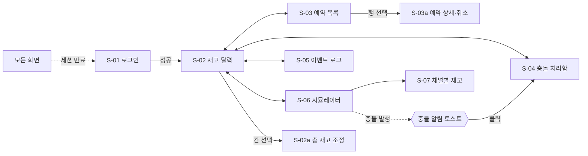

## 핵심 시나리오: "마지막 1실" 시연

심사자가 문제와 해결을 한 흐름으로 확인하는 시나리오다. E2E 테스트(Playwright)도 같은 흐름을 검증한다.

1. **S-01:** 로그인한다.
2. **S-06:** 객실타입과 날짜를 고르고 `남은 재고 1`, `요청 50건`, `통보형 40%`, `중복 10%`로 실행한다.
3. **S-06 결과:** 확정 1건, 나머지는 거절 또는 충돌이고 "초과 판매 0"이 표시된다.
4. **콘솔 틀:** 충돌 알림 토스트와 배지가 새로고침 없이 나타난다.
5. **S-04:** 충돌 하나를 "해결됨"(메모 입력)으로, 하나를 "취소"로 처리한다.
6. **S-02:** 해당 날짜가 매진으로 표시된다.
7. **S-07:** 모든 채널이 남은 재고 0(판매 중지)을 몇 초 안에 받았는지 확인한다.
8. **S-05:** 위 과정이 시간순으로 기록되어 있다.

## 와이어프레임 (HTML 목업)

화면마다 정적 HTML 목업을 만들고 스크린샷을 함께 둔다. 데이터는 모두 가짜 값이다.

| 경로 | 내용 |
|---|---|
| [`mockups/`](mockups/) | HTML 원본. 브라우저로 바로 열 수 있다. Tailwind CSS는 스택과 같은 4.3.3 버전의 브라우저 빌드를 CDN에서 불러온다. 공통 틀(메뉴, 충돌 배지, 알림)은 `shell.js`에 있다 |
| [`screenshots/`](screenshots/) | 1440px 너비 스크린샷 |
| [`mockups/capture.sh`](mockups/capture.sh) | 헤드리스 Chrome으로 스크린샷을 다시 만드는 스크립트 |

목업의 숫자는 "마지막 1실" 시연 시나리오의 한 시점으로 맞췄다.
- **시뮬레이션 조건:** 패밀리 스위트 10-10, 남은 1실, 50건
- **결과:** 확정 1, 거절 26, 충돌 18, 중복 5 (합계 50)
- **판매 수:** 4 ≤ 총 재고 4. 초과 판매 0건이다.
- **채널 동기화:** 5개 채널 중 4개는 0.5~0.7초 안에 판매 중지를 받았다. OTA C는 재시도 중이다.

같은 숫자가 재고 달력, 예약 목록, 충돌 처리함, 이벤트 로그, 채널별 재고 화면에 일관되게 나온다.

| 목업 기능 | 실제 구현 (front-end FSD) |
|---|---|
| `shell.js`의 메뉴·배지·알림 | `src/_app` 레이아웃과 widgets |
| `channelBadge`, `statusBadge` | `shared/ui/badges.tsx` (`entities` 레이어는 구현 중 없앴다. [front-end 구현 노트](../../3-development/front-end.md#설계에서-바뀐-점과-이유)) |
| 각 화면 HTML | `src/_pages`의 각 화면 |

### S-01 로그인 (REQ-18)

로그인에 실패했을 때의 상태다. 남은 시도 횟수를 보여준다.

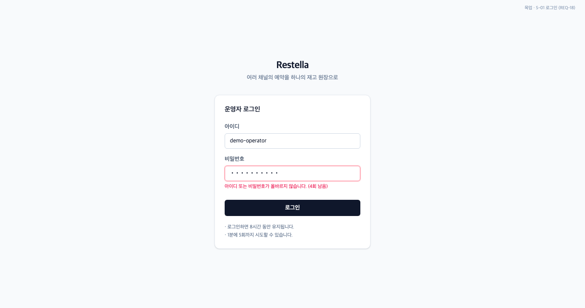

### S-02 재고 달력 (REQ-02)

객실타입 × 날짜 격자다. 남은 재고/총 재고를 보여주고, 1실 남음(노랑)과 매진(빨강)을 구분한다.

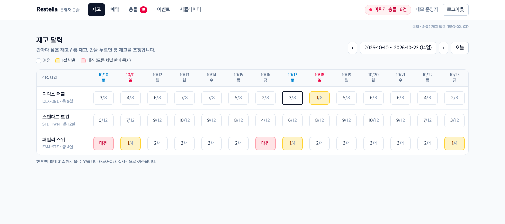

### S-02a 총 재고 조정 (REQ-03)

판매 수보다 작게 줄일 수 없다는 안내와, 저장하면 채널 동기화가 일어난다는 안내를 보여준다.

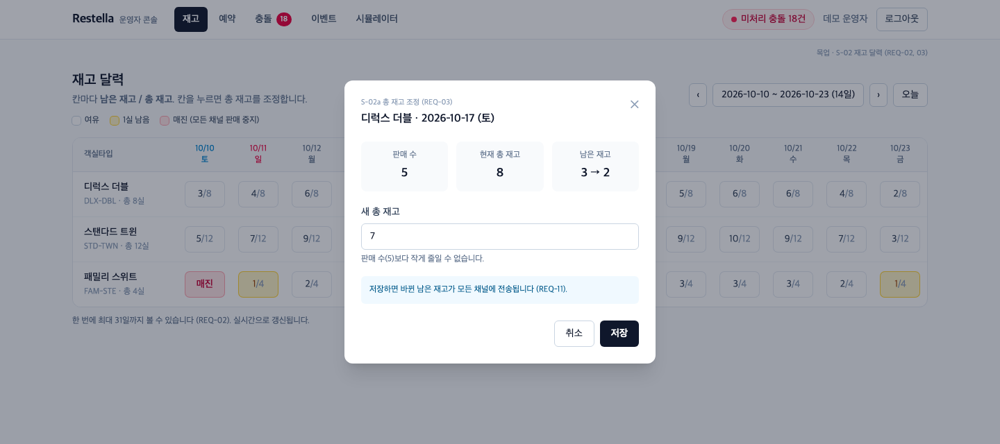

### S-03 예약 목록 (REQ-16)

채널 유형(확인형/통보형)과 상태(확정, 충돌, 거절, 취소)를 배지로 구분한다.

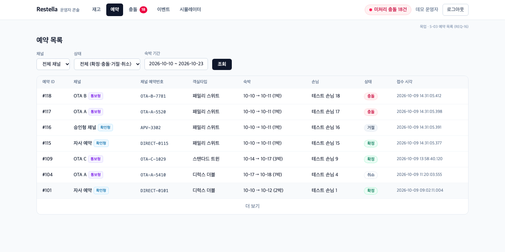

### S-03a 예약 상세·취소 (REQ-10)

차감된 숙박일, 이력(확정 → 동기화 → 중복 재전송), 취소하면 무엇이 복원되는지 보여준다.

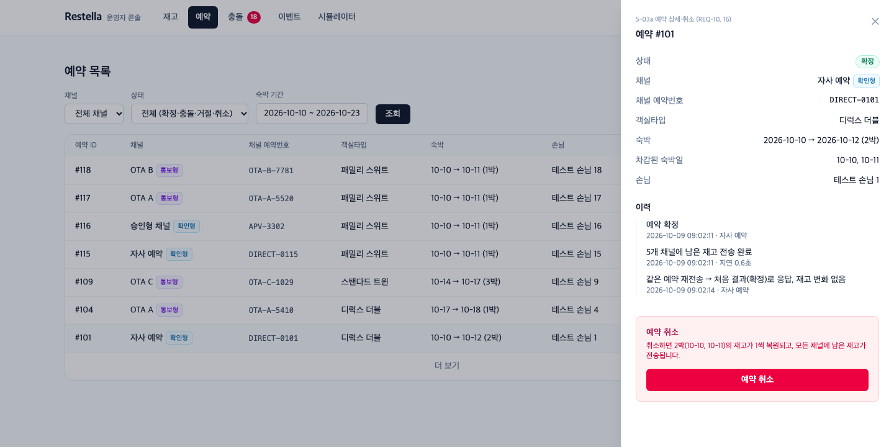

### S-04 충돌 처리함 (REQ-13, 14, 15)

방금 들어온 충돌을 강조한다. "다른 객실타입으로 옮기기"는 재고가 있는 객실타입이 있을 때만 활성화된다.

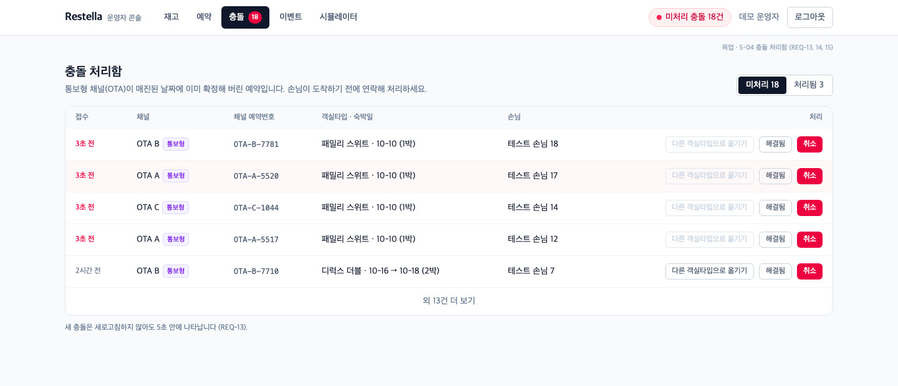

"해결됨" 처리에는 메모가 필수다(AC-14-2).

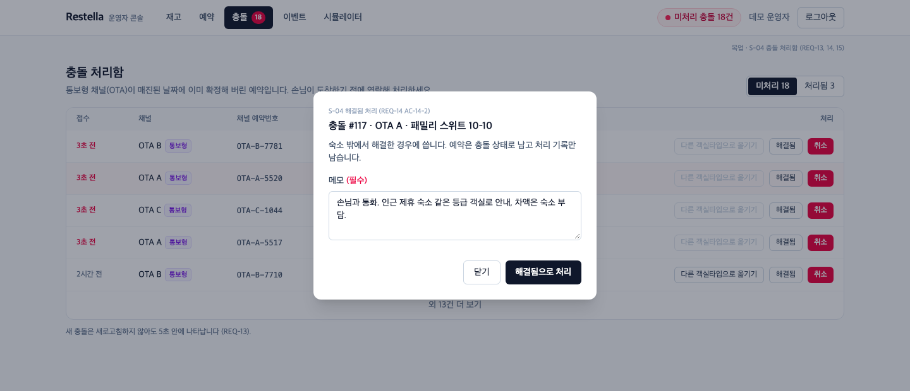

### S-05 이벤트 로그 (REQ-17)

시뮬레이션 한 번의 흐름이 밀리초 단위로 남는다: 재고 맞춤 → 확정 → 거절 → 중복 → 충돌 → 동기화 성공·실패 → 충돌 처리.

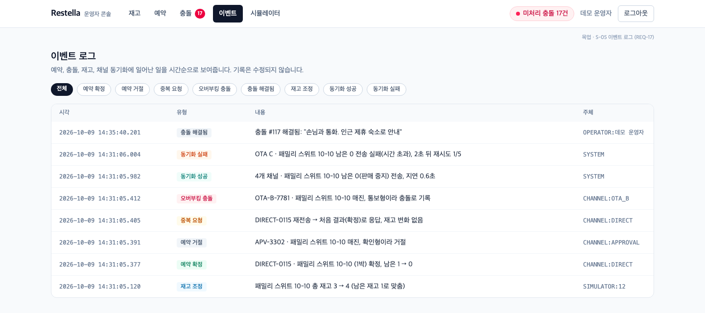

### S-06 동시 예약 시뮬레이터 (REQ-19)

결과 요약과 불변식 검증("초과 판매 0건")을 보여준다. 충돌 알림 토스트가 함께 뜬다(AC-13-2).

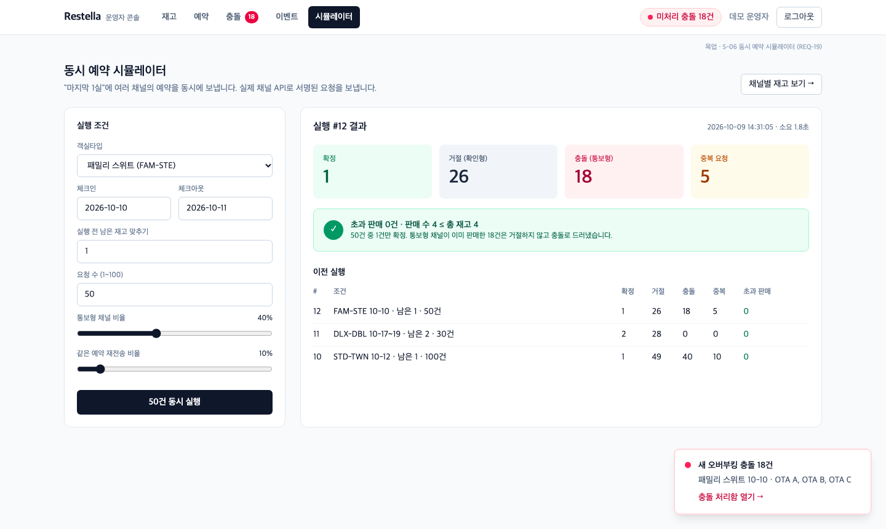

### S-07 채널별 재고 (REQ-20)

Restella 원장과 각 채널이 받은 값을 비교한다. 재시도 중인 채널은 "원장과 다름"으로 표시한다.

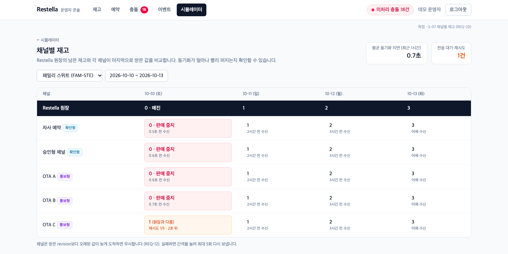
